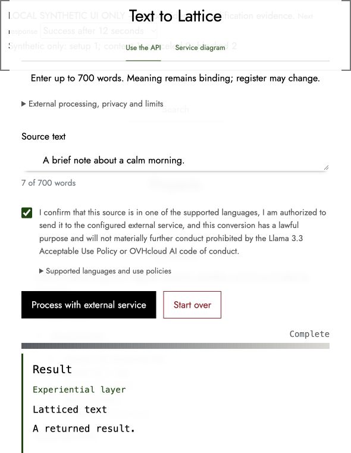

# Text to Lattice pause before reservation — November 13, 2026

The owner requested a usage-limit handoff, with the final UI screenshot completed first. This checkpoint records that pause. It authorizes no activation or final release and changes no product source.

## GitHub and release state

Product changes are already merged by PR #172 at main `5eb50a4ab3a07a7a94d7ce72436163893299bae5`. Exact-head CI #458 passed; ordinary held enforcement #459 passed. The last actual held Pages publication is #457. The latest observed API and public UI remained held; no new activation occurred during this checkpoint. The November 13 project-page date and requested modal implementation are present in main. GATE-02 and GATE-03 retain their dated bounded production adjudications. GATE-06 remains unaccepted: final native Safari/Brave captures and the qualification-bound hosted checks are outstanding.

This checkpoint is pushed only to the existing `codex/text-to-lattice-browser-evidence-run454` branch. Do not merge it before the selected qualification without reconciling the exact target: main and its verified held first parent `acebbf3a01296b1b9ff1d5de83740c10add2d788` deliberately remain intact. No branch or earlier progress was deleted.

## Final UI screenshot

Captured at 2026-11-13T22:06:13.412Z from the current main UI in the existing isolated loopback harness. It displays a fixed synthetic response, not a model-generated result. The harness blocks real API/network requests. The image shows the plain output background, terminal output, and right-aligned terminal completion label immediately above the bar. It is a visual record only: it does not establish provider behavior, native browser capture, G06, output quality or deployment success.

Original JPEG: 47,975 bytes; SHA-256 `a783352b476a0ed041692f925ab41f7d500e7e5e1e311d31597cd62538a511eb`. Independently reviewed after an exact base64 transfer. The local preview server and tab are closed.

## Exact operational stop

`U13-AFTER-RUN454-A1` remains funded 1, used 0, remaining 1, unreserved. No reservation, original lease, dispatch START, workflow POST, backend canary, native source entry or hosted Firefox check occurred in this unit. The local screenshot fixture is separate.

The actual PLAN, closed root review, batch input and CONFIG14 have passing independent reviews. The next operation is reservation only after current conditions are reconciled. No repeated control suite is needed merely because the chat resumes.

Retained workspace artifacts (relative to the original task workspace):

- `outputs/text-to-lattice-run454-pre-reservation-handoff-supplement.json`: current four views, exact references, absent operation markers, review ownership and next boundary.
- `work/proposals/nov13-final-ui-screenshot/root-final-ui-and-cleanup.json`: actual screenshot and cleanup facts.
- `work/evidence/u13r454-next-activation-plan.json`: 23,242 bytes, SHA-256 `e4be10e46433cc09c64b2079ba615f56454b856f3bc10019d16657bcc895b658`.
- `work/evidence/u13r454-next-activation-reservation-input-config.json`: 4,393 bytes, SHA-256 `6c51a265515b1e0c3a4d5ed1831de7c39d8b9598b469ab08acefe97b4b539e9a`.
- `work/proposals/u13-after-run454-downstream-preparation-DATA/final-activation-data-preparation/independent-actual-CONFIG14-and-command-review.json`: SHA-256 `0ec998852fdb5dceec382c52b63a174094a237fd0c10878830baa2cf1b6e90d9`.
- `work/proposals/u13-after-run454-runtime-preparation/current-original-BEFORE-AFTER-and-restore-readiness-handoff-DATA.json`: exact current context, metadata and restoration instructions.
- `work/proposals/u13-after-run454-runtime-preparation/restore-execution-descriptor-SOURCE-SCHEMA-CORRECTED.json`: SHA-256 `034edbd6217bfc9b74b9e37ffb3bc578a056485e0d77a97e1327dda2328b7084`.

All these private artifacts and their previous versions remain on disk. This public checkpoint is a concise continuation index, not a replacement for their contents or authority.

## Native cleanup and efficient resumption

Both unarmed collectors were disposed cleanly at 22:09:27 UTC. Safari's temporary “Allow Inspecting Web Inspector” setting was observed off at 22:10:02.995 UTC. Only owned Inspector/DevTools pairs were closed; the owned primary browser profiles remain. Firefox received no input during this unit. The screenshot transfer document is closed. No private browser source, output or cookie values were saved.

Keep the retained installer bytes and the existing owned profiles; no new transfer or general browser setup investigation is needed. Safari installer: 235,561 bytes, SHA-256 `2e9def65fea6344de06c9878ce7593a97f8d2222a0099ace68158e499f8d2a1e`; Brave installer: 148,288 bytes, SHA-256 `3c76baa45f6ad0f09008c7508cb090f730cc3dae870284228729e5970b7471e5`. The former collector objects are disposed and must not be represented as ready.

Dated native readiness, held observations and fresh metadata are not future guarantees. On resume, reconcile the necessary current facts and actual bindings without overwriting or replaying exclusive originals. Preserve all passing source, existing16, owned19, policy, raster and method reviews; do not rerun them absent a material change. Avoid changing main or inventing a replacement qualification identity simply for documentation.

After supported current prerequisites: consume/stage the sole reservation, review and adopt the actual spent state, then execute the complete reviewed activation batch. Keep each original 240-second lease uninterrupted; no handoff or compaction inside it. Once the backend, active artifact and BEFORE context pass, perform Firefox's 14 input-only checks first, then one native Safari pipeline and one native Brave pipeline. Both captures must seal before AFTER. Restore held API before Pages promptly on failure or completion, before heavy offline image/assembly work. Do not replay original #454, reuse its spent unit, waive a missing gate, or infer source-copy repair coverage from its retained-passage canary.
